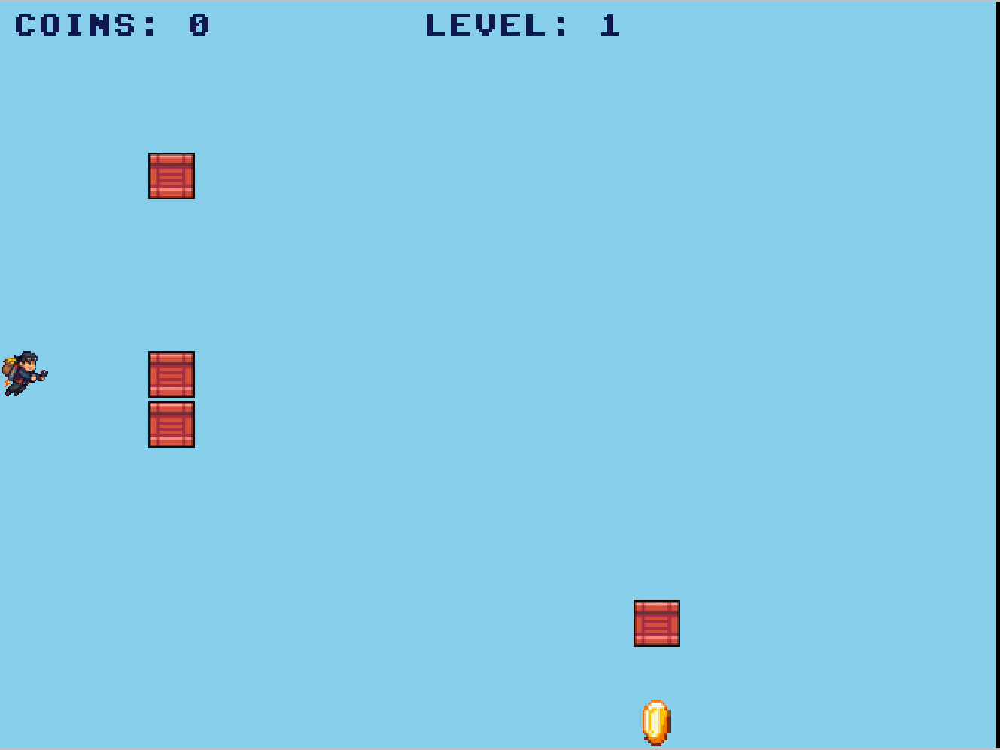

# Coin Rush — FPGA Video Game

*A documentation-only repository for an FPGA-based arcade game developed at the University of Pisa.*

**Languages:** [English](#english) · [Italiano](#italiano)

---

## English

### Overview

**Coin Rush** is a 2D arcade video game implemented in **Verilog RTL** on a **Terasic DE2 FPGA development board**. The player moves vertically to avoid scrolling obstacles, collect coins and progress through three levels. A collectible star provides temporary protection against an obstacle.

The project was developed for the *Digital Systems Design* course in the Master's Degree in Electronic Engineering at the **University of Pisa** (academic year **2026/2027**). Its architecture is modular and hardware-oriented: game control, object movement, collision detection, video generation and audio processing operate as interconnected RTL blocks.

### Main features

- **FPGA platform:** Terasic DE2, Altera Cyclone II EP2C35F672C6; 50 MHz system clock.
- **Video:** VGA 640 × 480, 25 MHz pixel enable, 10-bit RGB channels.
- **Gameplay:** vertical player movement, three obstacle generators, six obstacle shapes, collectible coins and a protective star.
- **Progression:** three levels with increasing difficulty; start, play, pause, level transition, game-over and victory screens.
- **Graphics:** 32 × 32 pixel sprites stored in a synchronous ROM, with transparency and drawing priority handled by the rendering pipeline.
- **Audio:** two-voice synthesis and a WM8731 codec interfaced through I²C and I²S.
- **Verification:** RTL testbenches, Quartus II synthesis and TimeQuest analysis, VGA simulation captures, and tests on the physical DE2 board.

### Project preview

[Start screen](screenshots/start.png) · [Pause screen](screenshots/pause.png)

*These screenshots are from the VGA RTL simulation. Tests on the physical FPGA are documented separately in the reports.*

### Technical reports

| Language | Document |
| --- | --- |
| Italian | [Coin Rush — Technical Report (IT)](docs/Coin_Rush_Report_IT.pdf) |
| English | [Coin Rush — Technical Report (EN)](docs/Coin_Rush_Report_EN.pdf) |

The reports cover specifications, FPGA architecture, the game FSM, VGA timing, collision and collection logic, sprite ROMs, the audio subsystem, verification methodology, resource utilization, timing analysis, and experimental results.

### Repository scope

This repository **contains documentation and demonstration screenshots only**. It is **not** a buildable or playable release: the complete Verilog RTL sources, project files and simulation environment are not included. The PDF appendices contain a few selected RTL excerpts for explanation.

---

## Italiano

### Descrizione del progetto

**Coin Rush** è un videogioco arcade 2D realizzato in **Verilog RTL** sulla scheda FPGA **Terasic DE2**. Il giocatore controlla il movimento verticale del personaggio per evitare gli ostacoli in scorrimento, raccogliere monete e completare tre livelli. Una stella collezionabile fornisce una protezione temporanea contro un ostacolo.

Il progetto è stato sviluppato nell'ambito del corso di *Progettazione di Sistemi Digitali* della Laurea Magistrale in Ingegneria Elettronica dell'**Università di Pisa** (anno accademico **2026/2027**). L'architettura è modulare e orientata all'hardware: controllo della partita, movimento, collisioni, generazione video e gestione audio sono implementati mediante blocchi RTL interconnessi.

### Funzionalità principali

- **Piattaforma FPGA:** Terasic DE2, Altera Cyclone II EP2C35F672C6; clock di sistema a 50 MHz.
- **Video:** VGA 640 × 480, abilitazione dei pixel a 25 MHz e canali RGB a 10 bit.
- **Gioco:** movimento verticale, tre generatori di ostacoli, sei geometrie, monete e bonus stella.
- **Progressione:** tre livelli di difficoltà crescente; schermate di avvio, gioco, pausa, passaggio di livello, sconfitta e vittoria.
- **Grafica:** sprite 32 × 32 memorizzati in ROM sincrona, con trasparenza e priorità di rendering.
- **Audio:** sintesi a due voci e codec WM8731 mediante interfacce I²C e I²S.
- **Verifica:** testbench RTL, sintesi Quartus II, analisi TimeQuest, schermate della simulazione VGA e prove sulla DE2 fisica.

### Anteprima

[Schermata iniziale](screenshots/start.png) · [Gameplay](screenshots/gameplay.png) · [Schermata di pausa](screenshots/pause.png)

*Le immagini provengono dalla simulazione RTL VGA; le verifiche effettuate sulla scheda fisica sono descritte nelle relazioni.*

### Relazioni tecniche

| Lingua | Documento |
| --- | --- |
| Italiano | [Relazione tecnica Coin Rush (IT)](docs/Coin_Rush_Report_IT.pdf) |
| Inglese | [Coin Rush Technical Report (EN)](docs/Coin_Rush_Report_EN.pdf) |

Le relazioni descrivono specifiche, architettura FPGA, FSM, temporizzazione VGA, logica di gioco, rilevamento delle collisioni, ROM grafiche, audio, metodologia di verifica, risorse utilizzate e risultati sperimentali.

### Contenuto della repository

La repository pubblica **soltanto le relazioni PDF e alcune schermate dimostrative**. Non include i sorgenti Verilog completi, i file di progetto o l'ambiente di simulazione e non permette quindi di compilare direttamente il gioco. Le appendici dei PDF riportano alcuni estratti RTL a scopo descrittivo.

---

## Authors / Autori

**Matteo Tonini · Antonio Tuma**  
University of Pisa / Università di Pisa — Electronic Engineering / Ingegneria Elettronica

## Copyright and reuse / Diritti e riutilizzo

This repository is publicly accessible for viewing and educational reference. **No reuse license is granted by the mere publication of these files.** The authors may add an explicit license for the written documentation after agreeing on the terms and checking the rights to any included third-party material.

Questa repository è consultabile pubblicamente a fini informativi e didattici. **La pubblicazione non concede automaticamente il diritto di riutilizzare i materiali.** Gli autori potranno aggiungere una licenza esplicita dopo averne concordato i termini e verificato eventuali materiali di terzi.
